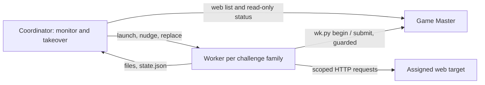

# Huntress 2026 web solver pipeline

This repository runs a coordinator and **one worker/session per web challenge
family**, with up to three families active concurrently by default. Python 3.11+
the `claude` CLI and `tmux` (for the default pane backend) are required. There are no
Python dependencies. Git, Rust, SSH and a run host are unnecessary.

**Workers own the solve end to end.** Each family's worker begins every mode, solves it,
and submits its own answers to the Game Master through `tools/wk.py`, then moves straight
on to the next mode (single solve → time trial → mastery). The worker holds the GM token
(a deliberate decision: it is a low-stakes CTF credential and a worker that submits
itself is faster and cannot lose an answer in a hand-off). **The coordinator submits
nothing.** It discovers routes, launches one worker per family, monitors them, and takes
over from failed workers (a replacement resumes the same Claude session with a brief built
from the failed worker's files and the Game Master's state). A single coordinator lock
prevents overlapping supervisors; all processes share one GM request rate limit.



## Quick start

`config.toml` is initialized for the external Huntress endpoint. Put
`HUNTRESS_GM_TOKEN=...` in `.env` at the repository root, or export it. No token is
stored in config. The internal proxy in HOMEBASE.md is unreachable here.

For a first live test, follow [the fresh-session guide](docs/fresh-session.md):
it separates read-only discovery, a single-route test, a whole family and a
release batch. The Python coordinator launches workers automatically.

```sh
python3 tools/orchcfg.py check
python3 -m unittest discover -s tests -v

# Read-only discovery: never starts attempts or launches agents.
python3 tools/web.py plan --day 21

# Offline rehearsal with synthetic, non-event data; no network or agent calls.
python3 tools/web.py plan --day 1 --catalog tests/fixtures/catalog.json

# Explicit solve command: untimed starts, agent work, and submissions.
python3 tools/web.py run --day 21 --execute

# Or select one challenge family and all its modes.
python3 tools/web.py run --day 21 --challenge web-exploitation-day-06-reflect-upon-this --execute

# Or exactly one mode route.
python3 tools/web.py run --day 21 --route web-exploitation-day-06-reflect-upon-this --execute

# Local state, then independently check cached routes against the GM.
python3 tools/web.py status --day 21
python3 tools/web.py status --day 21 --refresh

# Read a specific challenge's complete status without starting it.
python3 tools/web.py inspect --route web-exploitation-day-06-reflect-upon-this

# Poll for new routes. Omit --execute for a read-only release watcher.
python3 tools/web.py watch --day 22 --execute
```

Plain `run` behaves like `plan`. Neither `plan`, `inspect`, `status`, nor an
offline catalog can authorize execution. `watch` attempts each discovered route
once per invocation and never repeatedly spends worker budgets. Rerun `run`
explicitly to resume unfinished work. A completed attempt is recognized from GM
status without launching another worker. No automatic retry operation is sent.

`--day` means **release day**, not the number in the challenge id. The live
catalog has eight families (24 mode routes): three released on Day 19, two on
Day 20, three on Day 21. Day 21 contains curriculum challenges 06, 07 and 08.
See [the observed catalog](docs/live-web-catalog.md).

## Timing and scope

- All list requests use the canonical `lane=web-exploitation` (`web` is an API
  alias). Returned rows are filtered again through the
  strict web route allowlist; other lanes are never queried or assigned.
- Single-solve needs explicit `mode="single_solve"` metadata. Other modes need
  the literal boolean `run_for_time_supported=true`. Missing, conflicting or
  unfamiliar metadata blocks the job.
- Existing deadlines and timed/ranked eligibility block execution too: even a
  plain start could reconnect to a running timed attempt.
- There is **no** timed, ranked, retry, practice or one-shot override. Ranked
  campaigns and the old compiled-solver release/deploy tools are disabled.
- Progression requires confirmed CORRECT prerequisites. CORRECT with scoring
  pending is recorded separately; it is not a claim of awarded points.
- Workers receive the GM token (`HUNTRESS_GM_TOKEN` in their environment) and use it only
  through `tools/wk.py`, which keeps every guard: untimed only, exact `answer_ids`, matching
  `attempt_id`, bounded submissions, no retry/practice/reset/switch_target, own-family routes
  only. The prompt forbids sending the token to a target or calling the GM any other way.
  Worker Bash access is a trusted-agent permission boundary, not an OS sandbox, so this is
  enforced by prompt and by the tool, not by isolation. Artifact redirects are rejected.

## Files and worker settings

`workers/web/<base-id>/<mode>/` contains the complete `route.json`, `start.json`,
status snapshots, artifact bytes and SHA-256 manifest, `answers.json`, grading
results, per-round prompts and agent logs, `NOTES.md`, and worker-authored solver
code. New attempt IDs archive the old directory. No archives or supplied scripts
are executed. All runtime material is git-ignored; retain it for future work.

Real web assignments return live sites in `targets[]`, with no downloadable
artifacts. The coordinator records `targets.json`, waits through `preparing`,
then supplies the complete assignment to the worker. Untimed sites expire after
30 minutes without activity. If the team target limit is reached, the job holds;
it never switches off another challenge's target. Provisioning responses are
retained as `provisioning-*.json`.

Change `[agents]` in `config.toml` to select an installed Claude model, effort,
turn limit, permission mode or timeout. Authentication for Claude is configured
normally outside this repository. Workers have file and Bash tools only, without
delegation or MCP tools, and run in tmux panes (default) or headless print mode
(see [Parallel tmux workers](#parallel-tmux-workers)). Permission bypass modes are rejected.
`workers` controls concurrent challenge families (1–8, default 3). Each family
has `worker-session.json` and `challenge-state.json`; modes and feedback rounds
resume that family's Claude session from the same family directory. Each mode
keeps its own answers, evidence and notes. Workers may read earlier mode notes
within their family but never another family's files.

Workers automatically receive [lessons from earlier solves](docs/web-worker-lessons.md)
and may read historical .py/.md references under `solver_py_scripts/`. Mastery
can mix earlier vulnerability classes, so each assigned target is classified
independently and matched by question artifact label to target id. The shared
references are not active worker jobs and must not be edited or executed through
their old GM-facing CLIs. New solver code and evidence stay in the current job.

For an offline solver written by a worker, use
`python3 solve.py start.json deliveries`; it should print `{"answers": {...}}`.
Run it only after reviewing the authored script; compare its output to the
graded answers saved under `rounds/`. Target-dependent scripts need the current
assigned target and are not offline replay fixtures. Solvers are retained as
worker output and are not automatically promoted or executed by the coordinator.

## Worker flow and the coordinator's job

```sh
python3 tools/wk.py begin single_solve   # worker: start/reconnect the untimed attempt (waits as needed)
python3 tools/wk.py submit single_solve  # worker: submit answers.json; the GM result prints
python3 tools/wk.py status [--live]      # worker or human: state of every route in the family
python3 tools/wk.py next                 # first route that is not CORRECT
```

`WEB_FAMILY_DIR` (set for the worker) selects the family; a worker can only touch the routes
listed in its `family.json`. Exit codes: 0 ok, 1 blocked (message on stderr; do not work around
it), 75 still waiting (run the same command again).

The coordinator (`tools/web.py run|watch --execute`) per family: writes `family.json`, checks
the GM read-only (a family that is already CORRECT launches no worker), launches the worker,
then every `monitor_seconds`:

- **Done:** every mode CORRECT, or the next mode is held (timed/unknown metadata). The pane is
  closed after letting the worker finish its notes (`settle_seconds`).
- **Cross-check:** every `gm_poll_seconds` it reads the GM status of the family's current mode
  and trusts the GM over the worker's files (a worker that submitted but did not record it, or
  a teammate's solve, is picked up). Read-only: the coordinator never starts or submits.
- **Nudge:** a worker that ends its turn early gets a one-line message (up to `max_nudges`).
- **Takeover** (up to `max_takeovers` per run): the pane died, the worker kept stopping, it had
  no activity for `idle_seconds`, or it exceeded `timeout_seconds`. The old pane is killed and a
  replacement resumes the same Claude session (a launch that died within `min_session_seconds`
  starts a fresh one). Its prompt carries a brief (`takeovers/NNN.md`: reason, each route's
  state and last GM response, the old terminal's tail). `begin` is idempotent, so the
  replacement reconnects to the same attempt instead of redoing finished modes.
- **Needs attention:** takeover limit reached, or a trust/permission dialog stayed open for
  `stall_seconds` (`stalled.md`; it is never answered for the worker). Rerun the same
  `run --challenge ...` command after fixing it: leftover panes are replaced the same way.

## Parallel tmux workers

`[agents].backend = "tmux"` (the default) gives each family one interactive Claude pane, the
same split the sibling event repository's `rush.py` uses per lane, adapted to this pipeline's
per-family model. `--backend print` (or `backend = "print"`) runs one headless `claude --print`
process per launch instead: it cannot be nudged, so an early exit becomes a takeover, and it has
no activity heartbeat, so only process exit and `timeout_seconds` are watched.

```sh
tmux -L huntress-web attach -t web      # watch the family panes; detach with Ctrl-b d
python3 tools/web.py panes              # read-only: window, state and process per family
```

How it stays isolated from the sibling repository's workers, so both can run at once:

- **Private tmux server:** socket `huntress-web`, session `web`, started with `-f /dev/null`.
  The sibling repository uses `-L huntress`, session `rush`. Config loading and the backend
  both reject the sibling's socket (and `default`), so neither side can create, attach to,
  kill or message the other's windows.
- **Own state and lock:** panes run in `workers/web/<base-id>/` (no git worktrees are needed).
  The coordinator lock, request throttle, events file, sessions and markers live here only.
- **Credentials:** the pane gets `HUNTRESS_GM_TOKEN`/`HUNTRESS_GM_URL` via per-window `tmux -e`
  (not argv of the agent, not a file). Panes get `--add-dir solver_py_scripts` only, never the repo
  root, plus the same tool list as headless workers.
- **Shared GM, shared rate:** both repositories use the same Game Master and team. All processes
  here share one request gap through a lock file; it cannot throttle the sibling's. The lane
  allowlist keeps the two repositories on disjoint challenge families.

## Unattended speed and bottlenecks

Nothing in a normal solve needs a human:

- **Submit at once:** the worker submits the moment it has an answer and sees the GM's
  verdict itself; there is no hand-off. On CORRECT it begins the next mode immediately and
  finishes notes later. `incorrect`/`accepted` feed straight back into the same worker's
  session (bounded by `max_rounds` submissions per attempt, then `needs_work`).
- **No permission dialogs:** `[agents].allowed_tools` is a list of explicit allow rules (python3,
  curl, jq, file tools, ...) passed as `--allowedTools`. Blanket `Bash`/`*` rules and bypass modes
  are rejected at config load. A "Teach auto mode" tip picker is dismissed with Esc (it grants
  nothing); a real trust/permission dialog still stops the family for a human (see above).
- **Waiting on other completions** (all bounded, `[pipeline]`; nothing is reset, switched or
  retried). Waits live inside `wk.py begin`; one call waits at most `call_seconds`, then exits 75
  and is simply run again (the shell tool would time out otherwise); the overall bound is
  measured from the first wait:
  - *Scoring pending.* A CORRECT with `status=pending` unlocks the next mode only once confirmed.
    `begin` polls status every `pending_poll_seconds`, up to `pending_wait_seconds`.
  - *Team live-target limit* (`409 web_target_limit_reached` on start). The worker waits for any
    other family's worker to complete a route (they append to `workers/web/.events`, so the wake-up
    works across processes), then retries the plain start; if nothing finishes it retries every
    `capacity_poll_seconds` for up to `capacity_wait_seconds` (untimed sites free themselves after
    30 idle minutes). Each refusal is kept as a `provisioning-*.json`. If a teammate or the
    sibling repository holds the slots, only the timer can clear it.
  - A waiting family keeps its worker slot, so set `[agents].workers` to what the team's target
    limit can actually carry.

## API adapters and validation limits

Supported response shapes are documented in [docs/api-contract.md](docs/api-contract.md).
Unknown shapes stop with a diagnostic; they do not fall back to a guessed start.
`--catalog` accepts saved list responses for offline planning only. It cannot be
used to bypass live route discovery before execution.

On 2026-10-22, approved network-enabled execution successfully queried the live
web catalog, existing statuses and OpenAPI description, and validated the planner
against Day 21. The ordinary sandbox cannot resolve public DNS; request approval
for network-enabled execution in that environment. Tests include sanitized live
catalog/status fixtures plus synthetic target-readiness and concurrency cases.
No challenge was started/submitted and no real worker model was run during setup.
Fresh start/target-ready responses, the interactive Claude launch flags and the
worker-run `tools/wk.py` loop remain untested against the live GM and a real model
until an authorized untimed solve.

Read [AGENTS.md](AGENTS.md), [docs/policies.md](docs/policies.md),
[docs/runbook.md](docs/runbook.md), and the
[worker contract](playbooks/web-worker.md) before operating. The original general
playbooks, Rust reference excerpts and legacy helper tools remain for reference;
their multi-lane/ranked instructions do not apply to this initialized pipeline.
